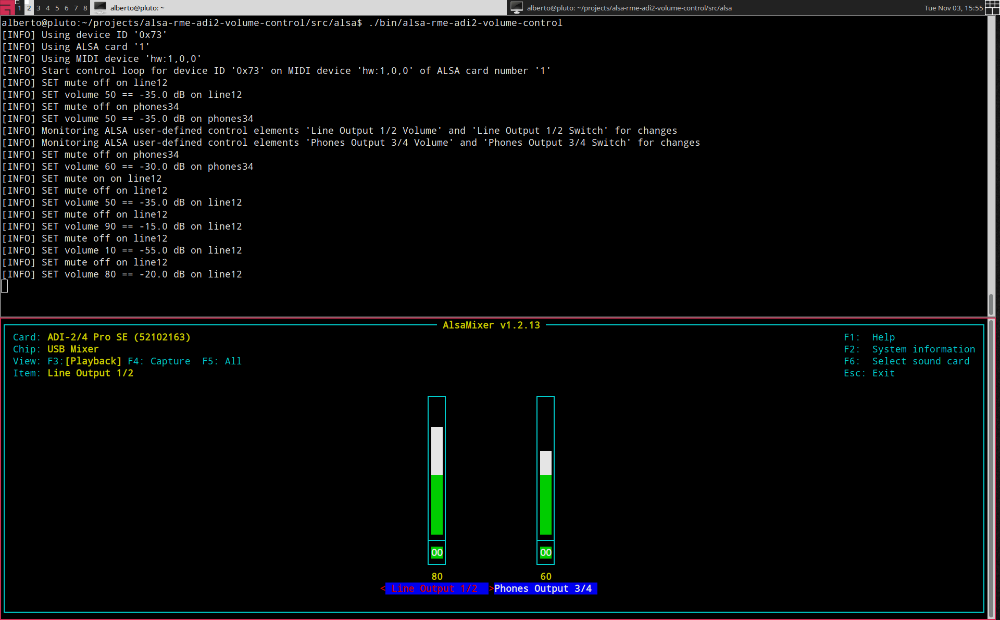
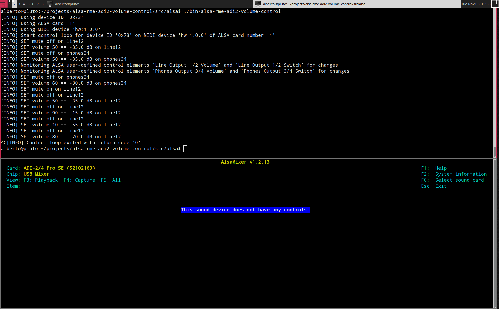

# alsa-rme-adi2-volume-control

A background service providing ALSA controls
to change the mute and volume state
of an RME ADI-2 device via its MIDI interface.


## Overview

This repository contains `alsa-rme-adi2-volume-control`,
a C program designed to be executed as a background service
on a modern Linux machine with
[ALSA](https://www.alsa-project.org/),
exposing user-defined control elements to change the mute and volume state
of an RME ADI-2 device connected to the running machine via USB,
via its MIDI interface.

The main purpose of `alsa-rme-adi2-volume-control`
consists in exposing such ALSA user-defined control elements
to client applications (e.g.,
[MPD](https://www.musicpd.org/),
[MOC](https://moc.daper.net/),
[moOde](https://moodeaudio.org/),
[Volumio](https://volumio.com/),
etc.) avoiding any software-based transformation
that might impact on the quality of the reproduced audio stream,
relying on the excellent hardware-based volume controls
of the RME ADI-2 device itself.

Some additional support files are provided:

- a `systemd` unit manifest to run the service in background
  on modern Debian-based Linux distributions;
- a `udev` rules definition file that allows applications
  in user-space to interact with an RME ADI-2 device
  without requiring elevated privileges;
- (TODO) a Bash script to automate installing and uninstalling
  the required files on a modern Debian-based Linux distribution.

### How It Works

The `alsa-rme-adi2-volume-control` registers two ALSA controls
(`mixer_type=hardware`) for outputs:

- `Line Output 1/2`
- `Phones Output 3/4`

on the ALSA card corresponding to the RME ADI-2 device.

Each control has two elements:

- a boolean switch, for the mute/unmute state of the output; and
- an integer logical volume, from `0` to `100`, for the volume of the output.

The service command line options
`--line12-min-db / --line12-max-db` and
`--phones34-min-db / --phones34-max-db`
allow the user to specify the levels, in dB,
on the actual RME ADI-2 device,
corresponding to the `0` and `100` logical volume values
for each output independently.

The service then listens for events on the registered ALSA controls,
and whenever a mute/unmute or volume change is detected,
the corresponding SET command is sent to the RME ADI-2 device
through its MIDI interface.

> [!NOTE]
> Currently the synchronization of the state is one-way only:
> from ALSA to the physical RME ADI-2 device.

> If the user changes the mute or volume state on the RME ADI-2 device
> (e.g., using the volume knob or the IR remote),
> the ALSA controls will not be updated accordingly.
>
> This is a known limitation which will be addressed in a future version.

#### Screenshots

Screenshot of the service running in foreground,
with `alsamixer` showing the registered ALSA controls:



Screenshot of the service after its termination,
with `alsamixer` no longer showing the registered ALSA controls:



### Supported RME ADI-2 Devices

The following families of RME ADI-2 devices are supported:

- `ADI-2 DAC`   (device ID: `0x71`)
- `ADI-2 Pro`   (device ID: `0x72`)
- `ADI-2/4 Pro` (device ID: `0x73`)

All device "variants" of each family should be supported
(e.g., `ADI-2/4 Pro SE` and `ADI-2/4 Pro EX` are both `ADI-2/4 Pro`),
since they share the same RME device ID
and the same MIDI interface for setting mute/volume parameters.


## Automated Installation

TODO write this


## Manual Installation

> [!TIP]
> This section is intended for expert users and developers only.
>
> Regular users should take advantage of the automated installation
> described in the previous section.

### Compile And Install The ALSA Plugin

#### Requirements

- [ALSA](https://www.alsa-project.org/wiki/Main_Page) (Debian/Ubuntu: `libasound2-dev`)
- [CMake](https://cmake.org/) (Debian/Ubuntu: `cmake`)

#### Compile

```bash
cd src/alsa
cmake .
make
```

The executable is written to `src/alsa/bin/alsa-rme-adi2-volume-control`.

#### Test

To test the `alsa-rme-adi2-volume-control` executable,
run a command similar to the following:

```bash
./bin/alsa-rme-adi2-volume-control
[INFO] Using device ID '0x73'
[INFO] Using ALSA card '1'
[INFO] Using MIDI device 'hw:1,0,0'
[INFO] Start control loop for device ID '0x73' on MIDI device 'hw:1,0,0' of ALSA card number '1'
[INFO] SET mute off on line12
[INFO] SET volume 50 == -35.0 dB on line12
[INFO] SET mute off on phones34
[INFO] SET volume 50 == -35.0 dB on phones34
[INFO] Monitoring ALSA user-defined control elements 'Line Output 1/2 Volume' and 'Line Output 1/2 Switch' for changes
[INFO] Monitoring ALSA user-defined control elements 'Phones Output 3/4 Volume' and 'Phones Output 3/4 Switch' for changes
...
```

and, on a different shell, run `alsamixer`,
selecting the card (hit `F6`) corresponding your RME ADI-2 device.

You should observe in the service log messages similar to the following ones,
and the volume of the selected output change on your RME ADI-2 device.

```bash
./bin/alsa-rme-adi2-volume-control
...
# mute "Line Output 1/2" in alsamixer
[INFO] SET mute on on line12

# unmute "Line Output 1/2" in alsamixer
[INFO] SET mute off on line12
[INFO] SET volume 50 == -35.0 dB on line12

# set "Line Output 1/2" to 90% in alsamixer
[INFO] SET mute off on line12
[INFO] SET volume 90 == -15.0 dB on line12

# set "Phones Output 3/4" to 70% in alsamixer
[INFO] SET mute off on phones34
[INFO] SET volume 70 == -25.0 dB on phones34

# mute "Phones Output 3/4" in alsamixer
[INFO] SET mute on on phones34

# unmute "Phones Output 3/4" in alsamixer
[INFO] SET mute off on phones34
[INFO] SET volume 70 == -25.0 dB on phones34
```

To terminate the service, simply hit `CTRL+C`
or use the `kill` or `pkill` commands with the `SIGTERM` signal:

```bash
./bin/alsa-rme-adi2-volume-control
...

# hit CTRL+C
^C
[INFO] Control loop exited with return code '0'
```

#### Usage

Run with `--help` to print the full usage message:

```bash
alsa-rme-adi2-volume-control --help
Usage: alsa-rme-adi2-volume-control [options]

Creates ALSA mute and volume controls for RME ADI-2 devices.

Options:
  -C, --card-number INTEGER       Use the ALSA card with the given index; if specified, overrides the card detected by --device-name; option --list-cards prints the detected ones
  -d, --device-name STRING        RME device name (default: 'autodetect'); option --list-device-names prints the supported ones
  -D, --device-id STRING          RME device ID; if specified, overrides the device ID detected by --device-name; option --list-device-ids prints the supported ones
  -h, --help                      Show this help
  -i, --line12-volume INTEGER     Initial volume for line output 1/2 (in [0, 100], default: 50)
  -I, --phones34-volume INTEGER   Initial volume for phones output 3/4 (in [0, 100], default: 50)
  -j, --line12-enabled INTEGER    Initial enable line output 1/2:   0 == muted, 1 == unmuted (default: 1)
  -J, --phones34-enabled INTEGER  Initial enable phones output 3/4: 0 == muted, 1 == unmuted (default: 1)
  -l, --line12-min-db DB          Minimum dB value for line output 1/2, corresponding to   0% volume (default: -60.0 dB)
  -L, --line12-max-db DB          Maximum dB value for line output 1/2, corresponding to 100% volume (default: -10.0 dB)
      --list-cards                List all ALSA cards and exit
      --list-device-ids           List all supported device IDs
      --list-device-names         List all supported device names
      --list-midi-devices         List all supported MIDI devices
  -M, --midi-device STRING        Use the specified MIDI device: 'autodetect' or 'hw:X[,Y[,Z]]'
      --no-line12                 Do not install controls for line output 1/2
      --no-phones34               Do not install controls for phones output 3/4
      --no-uninstall-on-exit      If specified, do not uninstall ALSA user-defined control elements when the program exits
  -p, --phones34-min-db DB        Minimum dB value for phones output 3/4, corresponding to   0% volume (default: -60.0 dB)
  -P, --phones34-max-db DB        Maximum dB value for phones output 3/4, corresponding to 100% volume (default: -10.0 dB)
      --uninstall                 Uninstall ALSA user-defined control elements and exit
  -v, --verbose                   Enable verbose output

Examples:
  alsa-rme-adi2-volume-control --list-cards
  alsa-rme-adi2-volume-control --verbose --device-name autodetect
  alsa-rme-adi2-volume-control --card-index 5 --device-id 0x73 --line12-min-db -25.0 --line12-max-db 0.0
```

By default, controls for both outputs
(`Line Output 1/2` and `Phones Output 3/4`)
will be created.
Use `--no-line12` or `--no-phones34` to prevent controlling either output.

When run without argument, the RME ADI-2 device to be used
will be autodetected (`--device-name autodetect`),
using the first (i.e., lowest index) ALSA card
that matches one of the supported RME ADI-2 devices,
along with the corresponding MIDI device.
This should work for most users,
who have only a single RME ADI-2 device attached.

Use `--card-number`, `--device-id` or `--device-name`, and `--midi-device`
to force a specific ALSA card, RME device ID, and MIDI device,
for instance if there are more than one RME ADI-2 devices attached.
For example:

```bash
# use the first ADI-2 Pro found, autodetecting the MIDI device
alsa-rme-adi2-volume-control --device-name "ADI-2 Pro"

# use the ADI-2/4 Pro connected as ALSA card #1, autodetecting the MIDI device
alsa-rme-adi2-volume-control --card-index 1 --device-name "ADI-2/4 Pro"

# use the ADI-2 DAC connected as ALSA card #5, using MIDI device hw:5,0,1
alsa-rme-adi2-volume-control --card-index 5 --device-id 0x71 --midi-device hw:5,0,1
```

To enable verbose logging, pass the `--verbose` option.

#### Listing ALSA Cards And MIDI Devices

To list all the ALSA cards available on the system,
attach your RME ADI-2 device and power it on,
then run the command with the `--list-cards` option:

```bash
alsa-rme-adi2-volume-control --list-cards
Index   ID      Name
0       hw:0    HDA Intel PCH
1       hw:1    ADI-2/4 Pro SE (52102163)
```

Similar information can be obtained with `aplay -l`:

```bash
aplay -l
**** List of PLAYBACK Hardware Devices ****
card 0: vc4hdmi0 [vc4-hdmi-0], device 0: MAI PCM i2s-hifi-0 [MAI PCM i2s-hifi-0]
  Subdevices: 1/1
  Subdevice #0: subdevice #0
card 1: vc4hdmi1 [vc4-hdmi-1], device 0: MAI PCM i2s-hifi-0 [MAI PCM i2s-hifi-0]
  Subdevices: 1/1
  Subdevice #0: subdevice #0
card 5: SE52102163 [ADI-2/4 Pro SE (52102163)], device 0: USB Audio [USB Audio]
  Subdevices: 0/1
  Subdevice #0: subdevice #0
```

Similarly, to list all the MIDI devices,
attach your RME ADI-2 device and power it on,
then run the command with the `--list-midi-devices` option:

```bash
alsa-rme-adi2-volume-control --list-midi-devices
MIDI Device     Card Name
hw:1,0,0        ADI-2/4 Pro SE (52102163)
hw:1,0          ADI-2/4 Pro SE (52102163)
hw:1            ADI-2/4 Pro SE (52102163)
```

Similar information can be obtained with `amidi -l`:

```bash
amidi -l
Dir Device    Name
IO  hw:1,0,0  ADI-2/4 Pro SE (52102163) Port
```

> [!NOTE]
> In the above examples, `hw:1,0,0`, `hw:1,0`, and `hw:1` are all valid
> MIDI device identifiers associated to the same RME ADI-2/4 Pro SE device.

> [!TIP]
> The above examples were obtained on a PC running GNU/Linux Debian testing,
> with the RME ADI-2/4 Pro SE connected to it via USB.

#### Install

> [!WARNING]
> Installing the executable, that is, copying it to `/usr/local/bin/`,
> requires `sudo` privileges.

```bash
sudo make install
```

### Install The `systemd` Service

> [!WARNING]
> Installing the `systemd` service requires `sudo` privileges.

```bash
# copy the new systemd file to /etc/systemd/system/
sudo cp src/systemd/alsa-rme-adi2-volume-control.service /etc/systemd/system

# reload the systemd daemon
sudo systemctl daemon-reload

# load the service
sudo systemctl restart alsa-rme-adi2-volume-control
```

### Install The `udev` Rules

> [!WARNING]
> Installing the `udev` rules requires `sudo` privileges.

```bash
# copy the new rules file to /etc/udev/rules.d/
sudo cp src/udev/99-alsa-rme-adi2-volume-control.rules /etc/udev/rules.d/

# reload and trigger rules
sudo udevadm control --reload-rules
sudo udevadm trigger
```


## License

This project is licensed under
the GNU General Public License v3.0 (GPLv3).

See the
[LICENSE](https://github.com/pettarin/alsa-rme-adi2-volume-control/blob/main/LICENSE)
file for details.


## Authors

- Alberto Pettarin ([Web](https://www.albertopettarin.it))

The approach of this project has been inspired by
[rme-adi2-pro-volume](https://github.com/JendaT/rme-adi2-pro-volume)
by
[Jenda Třešňák (JendaT)](https://github.com/JendaT),
although the Python service has been dropped,
and the code of the C service has been rewritten from scratch.


## Legal Disclaimers

RME is a registered trademark of RME Intelligent Audio Solutions,
a company registered in Germany (VAT ID: DE813455918).

Please refer to the
[RME Imprint](https://rme-audio.de/imprint.html).

This project and its authors are not affiliated
nor endorsed by RME.

